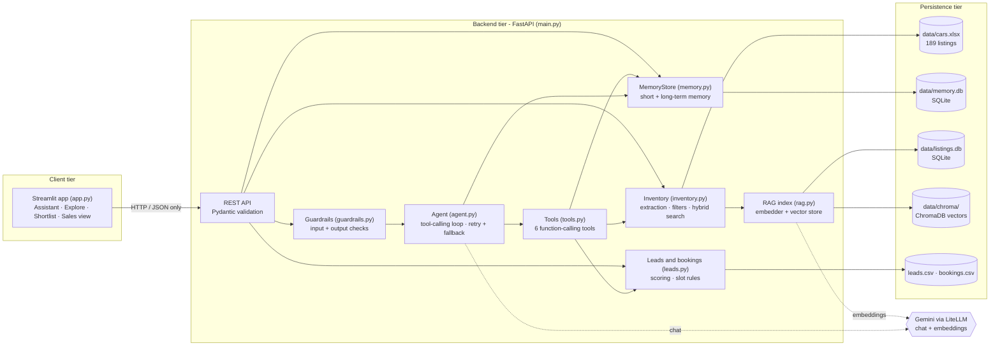
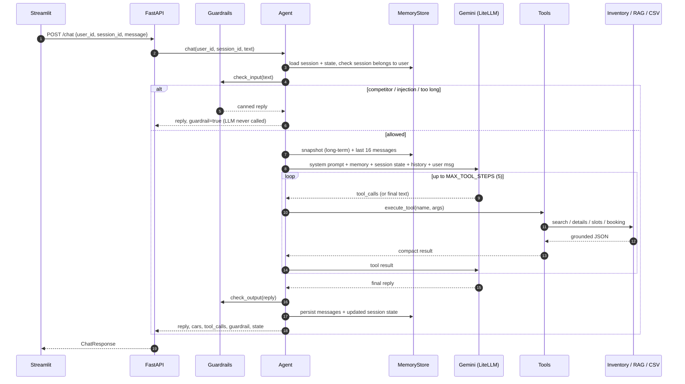
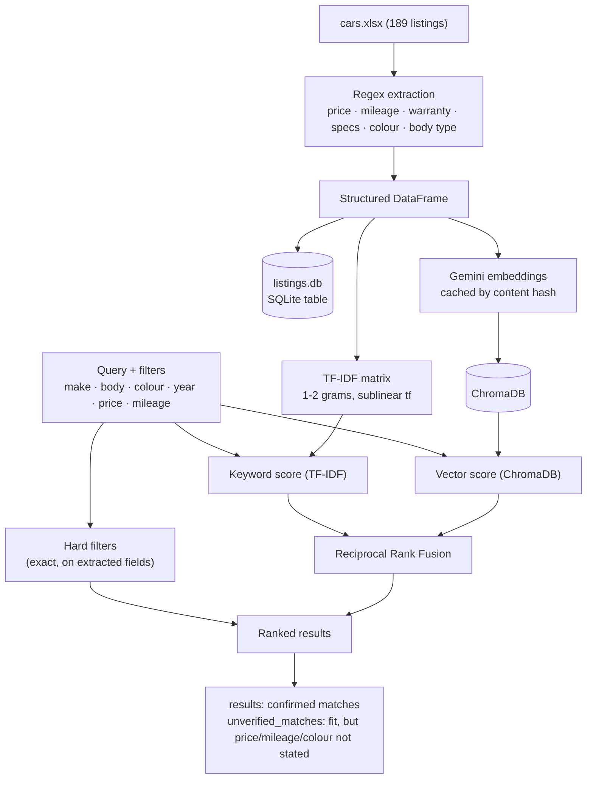
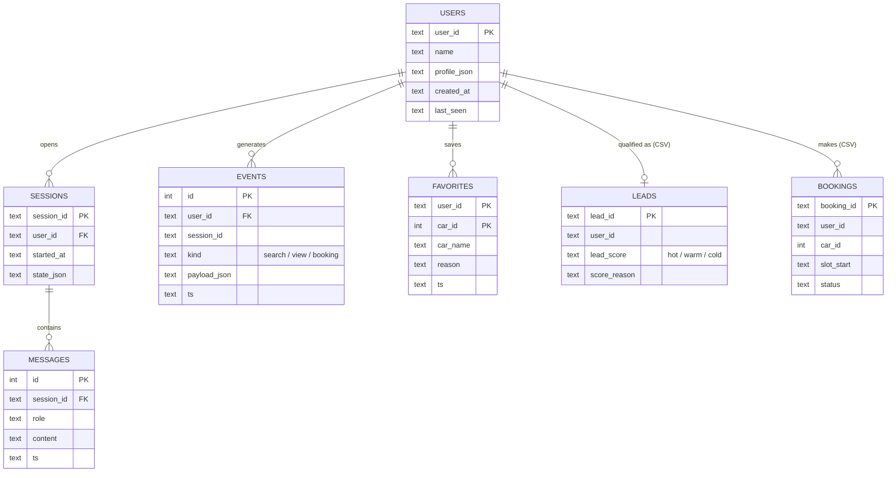
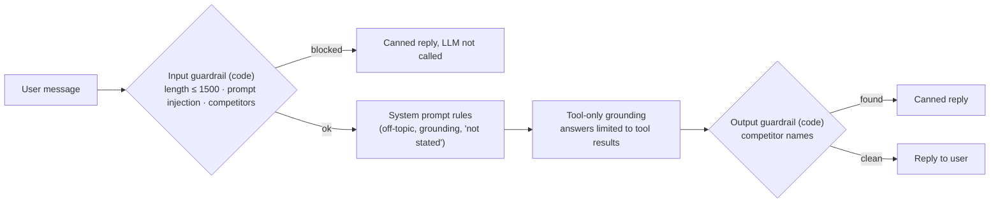

# dubizzle Car Assistant

An AI car-buying assistant ("Dubi") for the dubizzle cars marketplace. Users chat in natural language to explore a provided inventory of **189 listings**, ask follow-up questions about specific cars, book a viewing or test drive, and get recognised on their next visit.

**Stack:** FastAPI · LiteLLM + Gemini (free tier) · SQLite · ChromaDB · pandas · Streamlit · uv

| Capability | How it is done |
|---|---|
| Inventory search & retrieval | Hybrid RAG: structured filters + TF-IDF keyword + Gemini embeddings in ChromaDB, fused with Reciprocal Rank Fusion. Exposed to the LLM as tools. |
| Book viewing slots & qualify leads | Tool calls check real free slots (Mon-Sat, 8am-8pm, 1-hour, Dubai time) and write `data/bookings.csv`. Needs captured in conversation are upserted and scored (hot / warm / cold) in `data/leads.csv`. |
| Short-term memory | Last 16 messages plus a per-session state (`shown` cars, `focus` car) so "the first one" and "is there a warranty on it?" just work. |
| Long-term memory | Returning users are identified by user ID. Profile, favourites, searches, views and bookings persist in SQLite and drive a personalised greeting. |
| Intent recognition & guardrails | Greetings and chit-chat handled by the LLM; non-automotive requests politely declined; competitor mentions and prompt injection are blocked **in code**, not only in the prompt. |

## Contents

1. [Screenshots](#screenshots)
2. [Quick start](#quick-start)
3. [Try it](#try-it)
4. [Technical architecture](#technical-architecture)
5. [API design](#api-design)
6. [Design choices](#design-choices)
7. [Demo logs](#demo-logs)
8. [Project structure](#project-structure)
9. [Notes and known limitations](#notes-and-known-limitations)

---

## Screenshots

### Sign in
Any user ID works; reuse it next time and Dubi remembers you. The landing page lists what the assistant can do.


### Assistant: grounded search with car cards
A natural-language request ("a white SUV under $20,000") is converted to AED, answered only from tool results, and rendered with car cards. The reply also uses long-term memory ("since you've previously looked at Mercedes-Benz...") and flags listings that do not state a price instead of guessing.


### Long-term memory: returning user
A new session for the same user ID opens with a personalised greeting, quick-start prompts, and a **What I remember** panel in the sidebar (preferred makes, recent searches).


### Explore cars: direct search, no LLM
Filter by text, make, body type, year and price. This page calls `GET /inventory` directly and shows how many of the 189 listings state a price (36) or mileage (91). Each card has **Details**, **Save** (shortlist) and **Book** actions.


### Sales view: leads and bookings
A live view of `data/leads.csv` (scored leads) and `data/bookings.csv` (confirmed viewings), written automatically by the assistant's tool calls.


---

## Quick start

### Prerequisites
- Python 3.10+
- [uv](https://docs.astral.sh/uv/) (`pip install uv`, or see the uv install docs)
- A free Gemini API key from [Google AI Studio](https://aistudio.google.com/apikey)

### 1. Install

```bash
git clone <your-repo-url>
cd dubizzle-car-assistant
uv sync
```

### 2. Configure

```bash
cp .env.example .env        # Windows (cmd): copy .env.example .env
```

Open `.env` and set `GEMINI_API_KEY`. Everything else has a working default.

| Variable | Default | Purpose |
|---|---|---|
| `GEMINI_API_KEY` | none (required) | Chat and embeddings |
| `LLM_MODEL` | `gemini/gemini-3.8-flash` | Primary chat model |
| `LLM_FALLBACK_MODEL` | `gemini/gemini-3.5-flash-lite` | Used on rate limits, timeouts or a retired model |
| `EMBEDDING_MODEL` / `EMBEDDING_FALLBACK_MODEL` | `gemini/gemini-embedding-2` / `gemini/gemini-embedding-001` | Vector search |
| `USE_VECTOR_SEARCH` | `true` | Set `false` for keyword-only retrieval |
| `LLM_TEMPERATURE` / `LLM_TIMEOUT` | `0.2` / `60` | Sampling temperature · seconds per model call |
| `MAX_TOOL_STEPS` / `HISTORY_WINDOW` | `5` / `16` | Max tool-calling rounds per turn · messages replayed to the LLM |
| `API_URL` | `http://127.0.0.1:8000` | Where the Streamlit client finds the backend |

If a model name is rejected for your key, pick any model listed in AI Studio and keep the `gemini/` prefix.

### 3. Run the backend (terminal 1)

```bash
uv run uvicorn main:app --reload
```

- API: http://127.0.0.1:8000
- Interactive docs (Swagger): http://127.0.0.1:8000/docs
- The vector index builds in a background thread on startup. The API is usable immediately and falls back to keyword search until the index is ready (check `GET /rag/status`). Embeddings are cached by content hash, so restarts only embed new or changed listings.

### 4. Run the client (terminal 2)

```bash
uv run streamlit run app.py
```

Open http://localhost:8501, enter any user ID (and optionally your name) and start chatting. **Use the same user ID next time and Dubi remembers you.**

### Optional

```bash
uv run python scripts/ingest.py   # build/refresh the vector index by hand and print sample retrievals
uv run pytest                     # 93 tests, no API key or network needed
```

---

## Try it

| Say this | What to look for |
|---|---|
| "Show me white SUVs" | Grounded results with `#id`s (expand **How Dubi answered** to see the tool calls) |
| "What's the mileage on the first one? Is there a warranty on it?" | Short-term memory resolves "the first one" and "it" |
| "I'd like a test drive for #27 on Tuesday at 10am" | Availability check, name + phone collection, confirmed booking in `data/bookings.csv` |
| "Write me a Python script" / "Is it cheaper on dubicars?" | Polite decline, redirected back to cars |
| Start a **new session** with the same user ID | Personalised "Welcome back" greeting built from long-term memory |

The Streamlit app has four pages: **Assistant** (chat), **Explore cars** (direct search, no LLM), **My shortlist & visits**, and **Sales view** (leads and bookings).

---

## Technical architecture

### System overview

The system has three tiers with a strict boundary between them: a **Streamlit client** that only renders, a **FastAPI service** that owns all logic, and a **persistence layer** (SQLite, ChromaDB, CSV, Excel). The only external dependency is the Gemini API, reached through LiteLLM.



| Layer | Module | Responsibility |
|---|---|---|
| Presentation | `app.py` | Streamlit UI. Talks to the backend over HTTP only; shares no code or state with it. |
| Transport | `main.py`, `schemas.py` | Routes, request/response models, HTTP error mapping. |
| Orchestration | `assistant/agent.py` | Builds the prompt, runs the tool-calling loop, retries and falls back between models, builds the greeting. |
| Safety | `assistant/guardrails.py` | Deterministic checks before and after the LLM. |
| Capabilities | `assistant/tools.py` | Tool schemas and implementations: the only way the LLM touches data. |
| Domain | `assistant/inventory.py`, `rag.py`, `leads.py` | Field extraction, hybrid search, vector index, lead scoring, slot rules and bookings. |
| State | `assistant/memory.py` | SQLite-backed short- and long-term memory. |
| Config | `assistant/config.py` | Env-driven settings and business rules (opening hours, slot length, FX rate, timezone). |

### Chat request lifecycle

Every `POST /chat` turn follows the same explicit pipeline, so each step is testable on its own.



### Hybrid retrieval pipeline

Listings mix messy free text with structured columns (many prices, mileages and warranties exist only inside descriptions), so retrieval combines exact structure with fuzzy semantics.



- **Graceful degradation:** the retrieval mode is reported per query (`hybrid`, `vector`, `keyword` or `filters`). If the vector index is still building or embeddings fail, search silently falls back to keyword.
- **Idempotent ingestion:** each listing document is hashed; a restart only embeds new or changed listings.
- **Honest gaps:** only 36 of 189 listings state a price, so results are split into confirmed `results` and `unverified_matches`, and the assistant must label the latter as possible matches.

### Agent tools

The LLM never reads the dataset directly. Everything it knows comes from these tool results.

| Tool | Purpose | Side effects |
|---|---|---|
| `search_inventory` | Filtered + hybrid search; returns confirmed and unverified matches | Logs a `search` event; updates `shown` cars in session state |
| `get_car_details` | Full listing details for one car | Logs a `view` event; sets `focus` car |
| `check_viewing_availability` | Free 1-hour slots for a car on a date (Mon-Sat, 8am-8pm, Dubai time) | None |
| `book_viewing` | Confirms a slot after validating hours and conflicts in code | Appends to `bookings.csv`, upserts and re-scores the lead, saves name and phone, logs a `booking` event |
| `update_user_profile` | Captures budget, body types, makes, colours, must-haves, purpose, timeline | Writes long-term profile; upserts the lead |
| `save_favorite_car` | Adds a car to the user's shortlist | Writes `favorites` |

### Memory model

| Layer | Scope | Storage | What it holds | Used for |
|---|---|---|---|---|
| Short-term | One session | `messages` + `sessions.state_json` | Last 16 messages; `shown` car ids; `focus` car id | Resolving "the first one", "it", "that car" |
| Long-term | One user, across sessions | `users`, `favorites`, `events` | Profile, favourites, searches, views, bookings, last seen | Welcome-back greeting, personalised answers, lead enrichment |

Both layers are injected into the system prompt on every turn (`## What you remember about this customer` and `## Session state`).

### Data model



**Lead scoring** (`leads.score_lead`): **hot** = a viewing is booked; **warm** = budget captured plus preferences or liked cars; **cold** = anything less. Leads are one row per user and are re-scored every time the assistant learns more.

### Guardrails: defence in depth



| Layer | Enforced by | Covers |
|---|---|---|
| Input check | Code (`check_input`) | Over-long messages, prompt-injection phrases, competitor names (word-boundary regex) |
| System prompt | LLM | Off-topic requests, tone, "unknown is not no" for missing facts |
| Tool grounding | Architecture | No tool result, no claim; the model cannot invent listings, prices or availability |
| Business rules | Code (`leads.book_slot`) | Opening hours, Sunday closure, slot conflicts |
| Output check | Code (`check_output`) | Last line of defence against competitor names |

### Reliability and failure handling

| Failure | Behaviour |
|---|---|
| Rate limit, timeout, 5xx, connection error | Retry the primary model once after 4 s, then switch to `LLM_FALLBACK_MODEL` |
| Model retired or unavailable for the key | Skip straight to the fallback model; clear message if both are unavailable |
| Model rejects `reasoning_effort` | Automatically retried without it (`drop_params`) |
| Invalid API key | HTTP 503 with an actionable message ("check your .env") |
| Both models fail | HTTP 503; the UI asks the user to retry |
| Vector index not ready | Keyword + filter search; `GET /rag/status` shows progress |
| Tool-loop never converges | Capped at `MAX_TOOL_STEPS`, then a polite "could you rephrase" reply |
| Concurrent CSV writes | Guarded by a process-level lock around leads and bookings |

### Testing

93 pytest tests cover extraction, search, memory, tools, leads, guardrails, the agent loop, the API and RAG. They run offline: no API key and no network are needed, because the LLM and embedding calls are stubbed.

---

## API design

The backend is a resource-oriented JSON REST API built with FastAPI. Swagger UI is served at `/docs` and the OpenAPI schema at `/openapi.json`, so the contract is always generated from the code.

### Design principles

- **Thin, replaceable client.** The client talks to the backend over HTTP only. A notebook, `curl` or a mobile app can replace Streamlit.
- **One conversational endpoint.** `POST /chat` is the single LLM entry point; everything else is plain CRUD or search with no model in the loop (for example the Explore page uses `GET /inventory`).
- **Sessions are explicit.** A session is created first (`POST /sessions`) and its ID is passed on every chat call; the server checks that the session belongs to the user.
- **Identity is a slug.** `user_id` is normalised server-side (lower-cased, spaces to `_`, only `a-z 0-9 _ -`, max 40 chars), so `"Sara "` and `"sara"` are the same user. It is self-declared and not authenticated.
- **Validated input.** Request bodies are Pydantic models with length limits; invalid bodies return `422` automatically.
- **Guardrail hits are not errors.** A blocked message returns `200` with `guardrail: true` and a friendly reply, so the UI can render it like any other turn.
- **Grounded, inspectable responses.** Every chat response includes the `tool_calls` trace and the structured `cars` list, so the UI can render cards and a "How Dubi answered" panel without parsing text.
- **Privacy by design.** `DELETE /users/{id}/memory` wipes everything stored about a user.

### Endpoints

| Tag | Method & path | Purpose | Success | Errors |
|---|---|---|---|---|
| system | `GET /health` | Liveness, active model, listing count, vector-search readiness | 200 | |
| system | `GET /rag/status` | Vector index state and embedding model | 200 | |
| system | `POST /rag/rebuild` | Re-run ingestion (rewrite listings table, embed new/changed listings) | 200 | |
| chat | `POST /sessions` | Start a session; recognise returning users; return a memory-based greeting | 200 `SessionInfo` | 400 empty/invalid `user_id`, 422 |
| chat | `POST /chat` | One conversational turn | 200 `ChatResponse` | 404 unknown session, 503 LLM unavailable, 422 |
| inventory | `GET /inventory` | Direct search (filters + keyword + vector), no LLM | 200 | 422 |
| inventory | `GET /inventory/stats` | Dataset summary (`total_listings`, `with_price`, `with_mileage`, makes, body types) | 200 | |
| inventory | `GET /inventory/{car_id}` | Full listing details | 200 | 404 |
| memory | `GET /users/{id}/memory` | Long-term memory snapshot | 200 | |
| memory | `GET /users/{id}/sessions` | Session history | 200 | |
| memory | `POST /users/{id}/favorites` | Add to shortlist | 200 | 404 unknown car |
| memory | `DELETE /users/{id}/favorites/{car_id}` | Remove from shortlist | 200 | |
| memory | `DELETE /users/{id}/memory` | Right to be forgotten: wipe profile, sessions, favourites, events | 200 | |
| leads | `GET /leads` | Qualified, scored leads (sales view) | 200 | |
| leads | `GET /bookings` | Confirmed viewings and test drives | 200 | |

### Request and response contracts

**`POST /sessions`**

```jsonc
// request  (SessionStart)
{ "user_id": "sara", "name": "Sara" }          // user_id: 1-40 chars; name optional, max 60

// response (SessionInfo)
{
  "session_id": "d2f8b1a9bc4a...",
  "user_id": "sara",
  "is_returning": true,
  "greeting": "Welcome back, Sara! Last time, you were looking for a convertible/suv. ...",
  "memory": { "known": true, "profile": {}, "favorites": [], "recent_searches": [],
              "recent_views": [], "bookings": [], "sessions": 3, "last_seen": "..." }
}
```

**`POST /chat`**

```jsonc
// request  (ChatRequest)
{ "user_id": "sara", "session_id": "d2f8b1a9bc4a...", "message": "show me convertibles" }

// response (ChatResponse)
{
  "reply": "Here are a few convertibles ...",
  "cars":  [ { "car_id": 27, "name": "2019 Mercedes-Benz Glc Coupe", "year": 2019, "body_type": "coupe",
      "price_aed": null, "mileage_km": null, "colors": [], "photo_url": "https://..." } ],
  "tool_calls": [
    { "tool": "search_inventory", "arguments": "{\"body_type\":\"convertible\"}",
      "ok": true, "result_preview": "{'results': [...]}" }
  ],
  "guardrail": false,                             // true when code blocked the message
  "state": { "shown": [27, 31, 55], "focus": 27 } // short-term memory after this turn
}
```

**`GET /inventory`** query parameters: `q`, `make`, `model`, `body_type`, `color`, `min_year`, `max_year`, `max_price_aed`, `max_mileage_km`, `limit` (1-80, default 10). The response separates confirmed `results` from `unverified_matches` and reports the retrieval mode used.

**`POST /users/{id}/favorites`**

```jsonc
{ "car_id": 27, "reason": "Love the coupe styling" }   // reason optional
```

### Error format

Errors use FastAPI's standard envelope:

```json
{ "detail": "Unknown session - start one with POST /sessions" }
```

| Status | Meaning |
|---|---|
| 400 | `user_id` contains no letters or digits |
| 404 | Unknown session, or listing not found |
| 422 | Request body or query parameters failed validation |
| 503 | LLM unavailable: bad API key, model not available, or both models rate-limited or timed out |

### Typical client flow

```text
1. POST /sessions        {user_id, name}          -> session_id + greeting (shown immediately)
2. POST /chat            {user_id, session_id, message}   (repeat per turn)
3. GET  /inventory       ...                      (Explore page, no LLM)
4. POST /users/{id}/favorites                     (Save button)
5. GET  /leads, GET /bookings                     (Sales view)
6. DELETE /users/{id}/memory                      (Forget me)
```

### Example calls

```bash
curl -X POST localhost:8000/sessions -H 'content-type: application/json' -d '{"user_id":"sara","name":"Sara"}'
curl -X POST localhost:8000/chat -H 'content-type: application/json' \
     -d '{"user_id":"sara","session_id":"<id from above>","message":"show me convertibles"}'
curl 'localhost:8000/inventory?body_type=suv&color=white&max_price_aed=150000&limit=5'
curl localhost:8000/inventory/27
curl localhost:8000/rag/status
```

### Evolution notes

The API is unversioned for the prototype. For production, the natural steps are a `/v1` prefix, token-based authentication replacing the self-declared `user_id`, a streaming variant of `/chat` (Server-Sent Events), pagination on `/leads` and `/bookings`, and rate limiting per user.

---

## Design choices

**Why Streamlit, LiteLLM, hybrid retrieval and SQLite.** Streamlit gave a real chat UI with car cards, a shortlist and a sales view with very little code, while keeping a strict boundary: `main.py` owns all logic and `app.py` only renders what the API returns. LiteLLM provides one interface to Gemini for both chat and embeddings, with simple primary/fallback model switching for the free tier. I used a plain tool-calling loop rather than a heavy agent framework, so every step (guardrail, prompt build, tool call, persistence) is explicit and testable. The listings mix messy free text with structured columns (many prices, mileages and warranties appear only inside descriptions), so retrieval is hybrid: regex extraction turns descriptions into structured fields for exact filters, while TF-IDF and Gemini embeddings (stored in ChromaDB) handle fuzzy asks like "sporty" or "family car". SQLite stores memory because it is zero-setup, transactional and easy to inspect; the `MemoryStore` interface is small enough to swap for Postgres or Redis later.

**Implementation and what is next.** Grounding is the central design rule: the LLM never reads the dataset directly. It must call tools, and answers may only use tool results. Missing facts are reported as "not stated in the listing" (a missing warranty means unknown, not "no warranty"). Because only 36 of 189 listings state a price, searches return confirmed `results` separately from `unverified_matches` that fit but do not state, say, price or colour, and the assistant must label them as possible matches. Guardrails run in code around the LLM (input checks for competitors, prompt injection and length; an output check for competitor names), with the system prompt and LLM judgement covering off-topic requests. Booking enforces the opening hours and slot conflicts in code, so the model cannot invent availability. Out of scope for this prototype but natural next steps: real authentication instead of a self-declared user ID, response streaming, calendar/CRM integration and SMS or email confirmations, price negotiation and finance pre-qualification flows, multilingual (Arabic) support, map-based pickup, a summarised long-term memory for users with very long histories, and an evaluation harness for retrieval quality and guardrail regressions.

---

## Demo logs

Real conversations from this project's own `data/memory.db` (abridged for length; tool traces are visible in the app under **How Dubi answered**).

### 1. Multi-turn conversation exploring the inventory (short-term memory)

User `yes`, first session:

```text
DUBI > Hi! I'm Dubi, dubizzle's car assistant. I can help you search our inventory, compare cars and
       book a viewing or test drive. What kind of car are you looking for?

YOU  > I'm looking for a white SUV under $20,000
DUBI > We don't have any listings that explicitly confirm both a white color and a price under $20,000
       (around 73,450 AED), and there are 40 other SUVs where the price isn't listed.
       However, we do have a few possible matches where some details aren't stated in the listing:
       1. #92: 2021 Mercedes-Benz GLS 63 AMG - Japanese specs, 23,900 km, white/black, with warranty.
          Note: Price is not stated in the listing.
       2. #32: 2019 Jaguar F-Pace Prestige - GCC specs, AED 70,000 (~$19,050), 100,271 km, with warranty.
          Note: Colour is not stated in the listing.
       3. #23: 2017 Nissan X-Trail SL - White SUV. Note: Price is not stated in the listing.

YOU  > What's the mileage on the first one? Is there a warranty on it?
DUBI > For the 2021 Mercedes-Benz GLS 63 AMG (#92):
       - Mileage: 23,900 km
       - Warranty: Yes, includes warranty with unlimited claim limit and 24/7 roadside assistance,
         with options to extend up to 3 years and service contract packages available.
       Would you like to schedule a viewing or test drive for this Mercedes, or check out another car?

YOU  > i want to look for volkswagen
DUBI > We found a couple of Volkswagens within or close to your budget:
       1. #60: 2019 Volkswagen Beetle S - AED 32,000 (~$8,713), 36,000 km, American specs.
       2. #80: 2024 Volkswagen Golf GTI - GCC specs, grey, 11,000 km, with warranty.
          Note: Price is not stated in the listing.
```

"The first one" and "it" were resolved from session state with no re-stating of the car. The "Not stated in the listing" notes show the grounding rules at work.

### 2. Recalling preferences in a completely new session (long-term memory)

Same user `yes`, a new session created later (new `session_id`, empty chat history):

```text
DUBI > Welcome back, yes! Last time, you were looking for a white suv under AED 73,450, and you checked
       out the 2021 Mercedes-Benz Gls-Class GLS 63 AMG. Want to pick up where we left off, or start
       a new search?

YOU  > yes what we were lookig for
DUBI > We were looking for white SUVs under AED 73,450. [...] For instance:
       1. #32 - 2019 Jaguar F-Pace Prestige (GCC specs, AED 70,000, warranty till 2027)
       2. The 2021 Mercedes-Benz GLS (#92) or 2017 Nissan X-Trail (#23), where the price isn't listed.
```

User `sara` returning for a third session, with a booking and guardrail check:

```text
DUBI > Welcome back, Sara! Last time, you were looking for a convertible/suv. Want to pick up where we
       left off, or start a new search?
YOU  > I'd like to book a test drive for car #27 (2019 Mercedes-Benz Glc Coupe).
DUBI > [...] we have slots available tomorrow, Monday, November 23. How does 10:00 AM or 2:00 PM work?
       Since I already have your name as Sara, could you please confirm your phone number?
YOU  > book slot on Tuesday for 10 am
DUBI > Could you please share your phone number so I can finalize the test drive booking for you?
YOU  > +971-528994665
DUBI > Your test drive for the 2019 Mercedes-Benz GLC Coupe (#27) is fully confirmed!
       - Date: Tuesday, 24 November 2026   - Time: 10:00 AM - 11:00 AM
YOU  > where is burj khalifa?
DUBI > I can only help with cars and dubizzle listings - let me know if you'd like to explore any other vehicles!
```

Resulting rows written by the same conversation:

```text
data/bookings.csv  B0001,sara,Sara,+971-528994665,27,2019 Mercedes-Benz Glc Coupe,2026-11-24T10:00+04:00,...,test_drive,confirmed
data/leads.csv     L0001,sara,Sara,+971-528994665,,,convertible; suv,Mercedes,...,27,yes,hot,Viewing/test drive booked
```

---

## Project structure

```text
main.py                 FastAPI app: chat, sessions, inventory, memory, leads, RAG endpoints
app.py                  Streamlit client (HTTP only)
assistant/
  agent.py              System prompt, tool-calling loop, retries and model fallback, greeting
  tools.py              Tool schemas + implementations (search, details, availability, booking, profile, favourites)
  inventory.py          Excel loading, field extraction, hybrid search and ranking
  rag.py                SQLite listings table, Gemini embeddings, ChromaDB vector store
  memory.py             SQLite short- and long-term memory
  leads.py              Lead scoring (CSV), slot rules and bookings (CSV)
  guardrails.py         Deterministic input/output guardrails
  config.py, schemas.py Settings and API models
scripts/ingest.py       Build the vector index and show sample retrievals
data/cars.xlsx          Provided inventory (leads.csv, bookings.csv, *.db and chroma/ are generated at runtime)
docs/screenshots/       UI screenshots used in this README
tests/                  93 pytest tests (extraction, search, memory, tools, leads, guardrails, agent, API, RAG)
```

## Notes and known limitations

- **Free-tier limits:** if Gemini rate-limits a request, the agent retries and falls back to the second model. If both fail, the API returns a clear 503 and the UI asks the user to retry.
- **Prices:** all prices are AED (USD inputs are converted at 3.6725). Many listings simply do not state a price, and the assistant says so instead of guessing.
- **Identity:** the user ID is self-declared for the demo, not authenticated.
- **Generated data:** `data/memory.db`, `leads.csv`, `bookings.csv`, `listings.db` and `data/chroma/` are git-ignored and re-created automatically. Delete them to reset to a fresh state.
- **Secrets:** `.env` is git-ignored. Never commit your API key.
